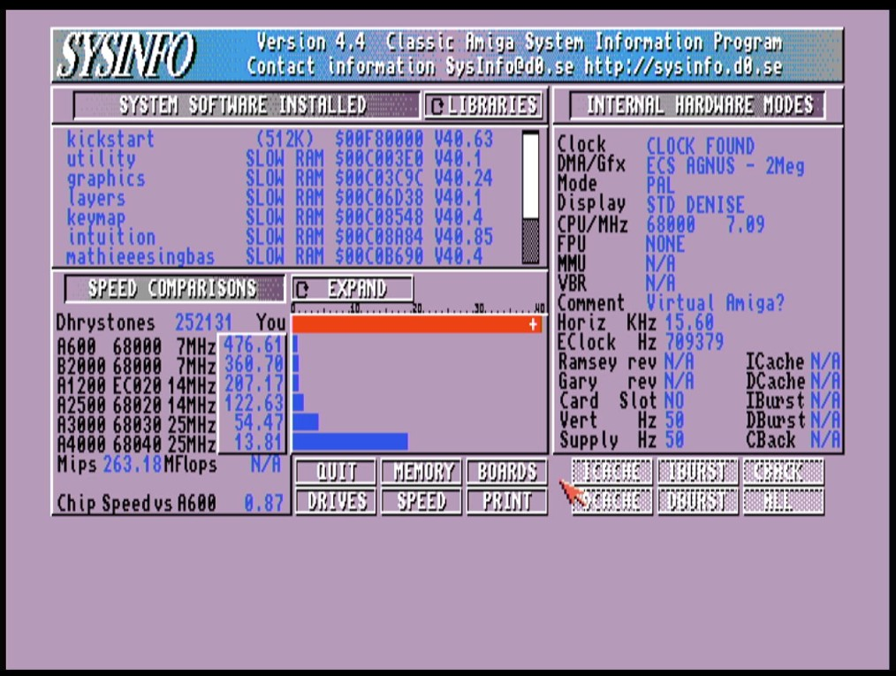

# Buffee and PJIT: Together at Last

*Draft. Placeholders in [brackets].*

In 2020 I drew the schematics for a small board that was going to plug into an Amiga's CPU socket and make it fast. I gave it a name, ordered the boards, and told people it would be done Soon<sup>(tm)</sup>. The boards arrived. The couple of months have since had a few children.

This is the story of why it took so long, what I believed that turned out to be false, and what finally made Buffee boot to Workbench on a 1 GHz ARM that thinks it is a 68000. There are binaries at the end, so you can skip to them if you only came for the downloads.

## What it is

**Buffee** is a board with an OSD335x (a 1 GHz Cortex-A8 with DDR3) that sits in the 68000 socket. A GreenPAK and one of the chip's PRU cores turn the ARM's memory bus into something the Amiga's chipset accepts as a 68000: AS, UDS, LDS, DTACK, the E clock, VPA/VMA, the interrupt levels and RESET.

**PJIT** is the software on it. It does not interpret a 68000 instruction at a time, or not only. For each of the 65,536 possible opcode words a generator, run once on a PC, writes the ARM instructions that do the job. Code that runs rarely is interpreted straight from those tables, code that runs a bit more is cached, and code that proves it's used a lot is turned into straight-line ARM code. The Amiga's registers live in ARM registers, the 68000's condition codes are the ARM's flags, and there is no compiler-generated code running while the guest runs.

## What I got wrong

**"It's a CPU, so the bus is easy."** A 68000 bus cycle is four clocks of the 7 MHz clock -- it's states are well known, what could possibly go wrong? 

I spent months trying to fight for "one more nine." I would get the bus running at 90%, then 99%, then 99.9%. Every one of them worked for a while and then failed after a few thousand, then a few million cycles at some phase of the moon. 

Four cycles is impossible with the AM3358.

Period.

There are several reasons for this -- the Sitara has a baked-in fabric delay, our bus runs entirely asynchronously and the GreenPAK->PRU loop makes it feel like I'm doing crochet with two baseball bats -- and it inevitably means six clocks is what this hardware does reliably, about 2.3 MB/s on the Amiga's own bus.

And by reliably, I mean 100.0000000% -- I've literally ran billions of runs with zero errors.

**"Faster is better."** Everything crashed the moment it ran at full speed. Demos and games depend on the CPU being slow, so there is a *pace governor* that makes interpreted code run at a 68000's speed; it is on by default.

This means running anything in the 24-bit memory space on real RAM will NOT run faster than a stock 68000. You won't even get the ~21 DMIPS Buffee is capable of in interpreted mode because memory accesses are really just that ... damned ... slow.

The way to get peak performance is not to use the 68K bus: code and data that lives in the board's own DRAM will run at full speed.

```Yes, I plan on allowing 680x0 instruction and data cache control of the physical L1 and L2 caches on the ARM, but at the moment, only 68000 is implemented, so such control would be impossible.```

**"8 MB of fast RAM for everyone."** Plenty of people already have a RAM expansion. Adding 8 MB at `$200000` collides with them, so the default is now no extra RAM, and one line in the menu
adds it.

Removing any 8MB expansion and enabling 8MB of CPU RAM will unlock full performance. I exmplain how below. If you have 8MB and really want to keep it, you can also put 1MB up at `C00000` instead to have the fastest slow RAM ever.

## What it does

Boots Kickstart 3.1 to Workbench on an A500+ (PAL), from the stock ROM and a floppy, and runs SysInfo. The figures from the benchmarks in the repository, on the board:

| | interpreted | translated |
|---|:---:|:---:|
| Dhrystone 2.1 DMIPS | 21.6 | 349 |
| BogoMIPS delay loop | 18.8 | 287 |
| SysInfo Mips | 0.43</br>(chip RAM) | 260~300</br>(local RAM) |



Interrupts reach a guest handler in about 6,300 cycles on average. Boot takes 0.4 seconds from power-up. The bus is the slow part and right now, I don't know how to get around it.

Some demos run, I'd tried State of Art and Planet Rock Lobster so far. Please dump any tests into the issue tracker, I'd be happy to receive feedback, even negative.

## Get it running

You need a Buffee in the 68000 socket of an Amiga and a 3.3 V FTDI USB-serial adapter on the board's UART header. The Amiga powers the board.

1. Download `bootloader.bin` and `buffee_boot.lzt` from **[here](https://github.com/nonarkitten/pseudo-jit/releases/tag/v1.0rc1)**.
2. Install the tools: `brew install arm-none-eabi-gcc` (or `apt install gcc-arm-none-eabi`), clone **[the repo](https://github.com/nonarkitten/pseudo-jit.git)**, run `make venv`.
3. Switch the Amiga on with the adapter connected, then `.venv/bin/python tools/buffee/restore_bootloader.py`. It sends the bootloader over XMODEM and writes it to the board's SPI flash.
4. With the menu on the screen, run `.venv/bin/python tools/buffee/restore_state.py`. It stores the PJIT bundle, copies *your Amiga's* Kickstart out of its ROM sockets into the flash, and sets the boot options.
5. Reset the board, or switch the Amiga off and on. Kickstart's insert-disk screen shows in about half a second.

Fast RAM is off by default so that an existing expansion is left alone. If you have none, `restore_state.py --region 200000/8` adds 8 MB of the board's DRAM at `$200000`; the menu (`ESC` three times, never in the first second after a reset, then `E`) changes it later.

If you don't want to clone the repo, you can just grab the binaries and use a program like Serial.app to transfer the file (just be sure to select XMODEM 1K when you drag-and-drop the bootloader.bin). Once there you can use `F` to load main PJIT and/or ROM binaries into extended portion of Flash and then head to `E` to set autoboot. No worries if you mess something up, press `ESC` thrice on the UART to get the menu back, or shortly after a power-on to completely erase the Flash and restart.

No, there are no easter eggs, don't go looking.

# What about Non-Amiga Systems?

There are two broken features right now -- the handling of the Function Code (FC) pins as well as the bus arbitration. One can be done, one is impossible with a bodge. So for now, don't use anything that needs these -- I'm not sure what does on the Amiga.

So for anything that DOES need these (like Mac or Atari), YMMV, but it probably just won't work right now.

# Where to Next?

With Buffee basically running, the next step is to get the `buffee` resident command implemented so people can change settings from within AmigaOS (some even on the fly, like clock speed), and then moving to 68040 mode, including:
- FPU emulation including both 68040 and 68882 instructions
- Extneded addressing modes
- Extra instructions

As well as allowing a 68EC020 mode which has most of the instructions from the 68040 but still limited to 24-bit addressing space. You know, just in case.

And I'm sure I'll keep trying to solve the bus speed issue as well, but I'm convinced that the GreenPAK and PRU are just not up to the challenge.